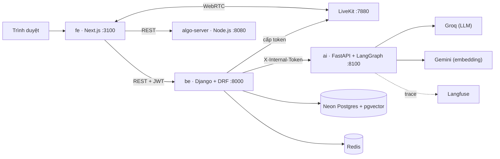

<div align="center">


### Nền tảng học tập trực quan có AI hỗ trợ

Học thuật toán qua mô phỏng từng bước · Học giải phẫu qua mô hình 3D · Lớp học trực tuyến tương tác

[](https://github.com/ductrien261/synapse-lab/actions/workflows/ci.yml)


[English summary](#english-summary) · [Tính năng](#tính-năng) · [Kiến trúc](#kiến-trúc) · [Chạy dự án](#chạy-dự-án-lần-đầu) · [Giấy phép](#giấy-phép)

</div>

---

## Giới thiệu

**Synapse Lab** là nền tảng học tập trực quan có AI hỗ trợ. Nền tảng giúp sinh viên **CNTT** học thuật toán qua mô phỏng từng bước, và sinh viên **Y khoa** học giải phẫu qua mô hình 3D tương tác. Giáo viên có thể mở **không gian học** để dạy trực tuyến với video, bảng trắng, bài giảng PDF và câu hỏi tương tác.

Kiến thức do AI đưa ra **bám vào giáo trình thật** (RAG, truy xuất từ kho tài liệu đã nhập), có nguồn trích dẫn, thay vì sinh nội dung tùy ý. Mọi lần gọi AI đều đi qua một cổng có hạn mức, nhật ký và theo dõi chi phí.

## Tính năng

Trạng thái dưới đây là những gì **đang có trên nhánh `main`**, đã được kiểm bằng bộ test tự động.

### Trực quan hóa thuật toán
- **73 thuật toán** trong 8 nhóm (Backtracking, Branch and Bound, Brute Force, Divide and Conquer, Dynamic Programming, Greedy, Simple Recursive, Uncategorized), mô phỏng **từng bước** có mã nguồn đi kèm.
- Phần giải thích do AI viết nháp, **quản trị viên duyệt** trước khi hiển thị; có bản bài học riêng cho Hamilton, Knight's Tour, Backtracking.
- Gia sư AI theo ngữ cảnh thuật toán đang xem.

### Giải phẫu 3D
- Xem mô hình 3D theo từng **hệ cơ quan**, bấm vào bộ phận để tra cứu kiến thức, chú thích và đoạn giáo trình liên quan.
- Quản trị nhập mô hình từ Sketchfab và AnatomyTOOL, AI viết nháp nội dung cấu trúc, quản trị **duyệt hoặc loại** từng bản nháp.

### Không gian học (lớp học trực tuyến)
- Tạo không gian, tham gia bằng **mã lớp**; giáo trình chia thành các phần, mỗi phần có tài nguyên (PDF, liên kết, mô hình 3D).
- **Họp video** bằng LiveKit (chạy sẵn trong Docker), **bảng trắng cộng tác**, **trình chiếu PDF** có chú thích và chọn văn bản.
- **Bình chọn trực tiếp** và **bài kiểm tra trực tiếp** kèm báo cáo kết quả.
- **Trợ lý AI** cho giáo viên (copilot soạn bài, tạo câu hỏi) và cho học viên (hỏi đáp trong lớp).
- Chiếu **mô hình giải phẫu 3D** ngay trong buổi học.

### Gia sư AI và học tập cá nhân
- Hỏi đáp có dẫn nguồn, kiểm tra nhanh (quick check), hành động học tập, lịch sử hội thoại, đánh giá câu trả lời.
- **Hồ sơ người học**: mức thành thạo từng khái niệm, các hiểu lầm hay gặp, **ôn tập ngắt quãng** theo lịch.
- Ghi chú học tập, chuỗi ngày học, bảng tổng quan, dịch nội dung sang tiếng Việt.

### Quản trị
- Người dùng và phân quyền; **cổng AI** với hạn mức token theo ngày, bảng giá, nhật ký yêu cầu và chi phí.
- **Kho tài liệu**: nhập giáo trình OpenStax, tải PDF, nguồn tuyển chọn, tìm kiếm vector, xem trước và loại bỏ phần không dùng.
- Phản hồi người dùng, ngân hàng câu hỏi, giám sát chất lượng và hệ thống.

## Kiến trúc



- `be` là **cổng**: đăng nhập, hạn mức token/ngày, ghi nhật ký và chi phí mọi lần gọi AI, lưu dữ liệu.
- `ai` là **bộ não**: các quy trình LangGraph (viết nháp, gia sư, ra đề, chấm bài). Chỉ `be` gọi vào, `ai` không ghi CSDL.
- Phòng họp video dùng LiveKit; backend cấp token cho thành viên đã vào phiên, trình duyệt kết nối trực tiếp đến LiveKit.

| Thành phần | Công nghệ |
|---|---|
| Frontend | Next.js 16, React 19, TypeScript, Tailwind CSS 4 |
| Backend | Django 5, Django REST Framework, SimpleJWT, drf-spectacular (Swagger) |
| Thuật toán | algorithm-visualizer (server, tracers, kho thuật toán) đã tách riêng và mở rộng |
| AI | FastAPI, LangChain, LangGraph, Langfuse; Groq (LLM), Gemini (embedding) |
| Thời gian thực | LiveKit (video), bảng trắng và bình chọn cộng tác |
| Cơ sở dữ liệu | Neon Postgres (Singapore) + pgvector |
| Cache | Redis |
| Đóng gói và CI | Docker Compose, GitHub Actions |
| Quản lý gói | `uv` (Python), `npm` (Node) |

## Chất lượng

Mỗi Pull Request chạy tự động (GitHub Actions) và phải xanh mới được gộp:

| Kiểm tra | Nội dung |
|---|---|
| Backend | `manage.py check`, kiểm migration, 107 test trên Postgres có pgvector |
| AI | 38 test pytest |
| Frontend | typecheck, lint, build |
| Algo-server | test mô phỏng thuật toán |
| Docker Compose | kiểm cú pháp cấu hình |

---

## Chạy dự án lần đầu

**Cần cài sẵn:** [Docker Desktop](https://www.docker.com/products/docker-desktop/) và Git. Chỉ vậy là chạy được.

### 1. Clone

```bash
git clone git@github.com:ductrien261/synapse-lab.git
cd synapse-lab
```

### 2. Tạo file `.env`

```bash
cp .env.example .env          # PowerShell: Copy-Item .env.example .env
```

Mở `.env` và điền:

- `DATABASE_URL` — **nhắn leader** để được cấp một Neon branch riêng (xem [Làm việc với database](#làm-việc-với-database)).
- `S3_*` — Neon Object Storage để lưu giáo trình PDF (Neon Console → Object storage → Connect). Để trống thì file lưu local trong `be/media/`.
- `GROQ_API_KEY` — LLM cho service AI (dịch, viết nháp, gia sư...), tạo miễn phí tại <https://console.groq.com/keys>.
- `GEMINI_API_KEY` — embedding cho kho giáo trình, tạo miễn phí tại <https://aistudio.google.com/apikey>.
- `AI_SERVICE_TOKEN` — chuỗi bí mật bất kỳ để `be` gọi service `ai`.
- `LANGFUSE_*` — (tùy chọn) xem trace từng bước AI trên <https://cloud.langfuse.com>.

> ⚠️ `.env` chứa key thật, **không bao giờ commit** file này (đã có trong `.gitignore`).

### 3. Khởi động

```bash
docker compose up -d --build
```

Lần đầu mất vài phút để tải image và cài thư viện.

### 4. Tạo bảng trong database

```bash
docker compose exec be python manage.py migrate
```

### 5. Tạo tài khoản admin và dữ liệu nền

```bash
docker compose exec be python manage.py createsuperuser
docker compose exec be python manage.py init_data
```

`init_data` tạo danh sách hệ cơ quan chuẩn và đồng bộ danh mục thuật toán từ algo-server. **Không tạo dữ liệu giả.** Chạy lại nhiều lần không bị trùng.

### Phòng học LiveKit

LiveKit Server đã nằm trong `docker-compose.yml`, nên không cần chạy `livekit-server.exe` ở terminal riêng. Khởi động toàn bộ hệ thống bằng:

```bash
docker compose up --build
```

Compose chạy LiveKit ở chế độ dev với cặp khóa `devkey` / `secret`. Trình duyệt kết nối qua `ws://localhost:7880`, còn backend kết nối nội bộ qua `http://livekit:7880`. Các cổng `7880/tcp`, `7881/tcp` và `7882/udp` được mở cho signaling và WebRTC.

Các giá trị có thể thay đổi trong `.env`:

```env
LIVEKIT_WS_URL=ws://localhost:7880
LIVEKIT_API_URL=http://livekit:7880
LIVEKIT_API_KEY=devkey
LIVEKIT_API_SECRET=secret
LIVEKIT_NODE_IP=127.0.0.1
```

`localhost`/`127.0.0.1` chỉ phù hợp khi mở lớp trên chính máy chạy Docker. Nếu thử từ điện thoại hoặc máy khác trong cùng mạng LAN, đặt `LIVEKIT_WS_URL=ws://<IP_LAN>:7880` và `LIVEKIT_NODE_IP=<IP_LAN>`, rồi tạo lại service bằng `docker compose up -d --force-recreate livekit be`.

Đây là cấu hình phát triển local. Khi triển khai Internet cần domain `wss://`, TLS hợp lệ, cấu hình IP public/TURN và firewall phù hợp.

Muốn có mô hình 3D để học: vào trang quản trị để nhập, hoặc dùng lệnh:

```bash
docker compose exec be python manage.py add_anatomy_model https://sketchfab.com/models/<mã>/embed --system cardiovascular --publish
```

Xong. Mở <http://localhost:3100> và đăng nhập bằng tài khoản vừa tạo (ô Email gõ `admin` cũng được).

---

## Địa chỉ các dịch vụ

| Dịch vụ | URL |
|---|---|
| Web | <http://localhost:3100> |
| API backend | <http://localhost:8000/api/> |
| Tài liệu API (Swagger) | <http://localhost:8000/api/schema/swagger-ui/> |
| Django Admin (dự phòng cho dev) | <http://localhost:8000/admin/> |
| Kiểm tra backend sống | <http://localhost:8000/api/health/> |
| Algo server | <http://localhost:8080/api/algorithms/> |
| LiveKit signaling | <http://localhost:7880> |

### Chia sẻ bản demo qua VS Code Ports

Khi các container đang chạy, trong VS Code mở **Ports** → **Forward a Port** → nhập `3100`. Đổi **Port Visibility** thành **Public**, rồi gửi **Forwarded Address** cho người xem demo. Frontend chuyển tiếp yêu cầu backend và algo-server qua cùng cổng `3100`, nên chỉ cần chia sẻ một link. Người xem đăng nhập bằng tài khoản của họ; giữ máy, Docker và VS Code đang chạy trong lúc demo.

---

## Lệnh thường dùng

```bash
# Xem log (Ctrl+C để thoát)
docker compose logs -f be
docker compose logs -f fe

# Dừng / khởi động lại
docker compose down
docker compose restart be

# Django
docker compose exec be python manage.py sync_algorithms      # cập nhật danh mục thuật toán từ algo-server
docker compose exec be python manage.py makemigrations <tên_app>
docker compose exec be python manage.py migrate
docker compose exec be python manage.py shell

# Thêm thư viện Python (chạy trên máy, trong thư mục be/)
cd be && uv add <tên_gói> && cd ..
docker compose up -d --build be

# Thêm thư viện Node cho frontend
docker compose exec fe npm install <tên_gói>
cd fe && npm install && cd ..          # cập nhật node_modules trên máy cho VS Code
```

---

## Cấu trúc thư mục

```
synapse-lab/
├── ai/                  Service AI (FastAPI + LangGraph), xem ai/README.md
├── be/                  Django backend
│   ├── core/            settings, urls gốc, lệnh init_data
│   ├── users/           tài khoản, đăng nhập, phân quyền
│   ├── knowledge/       tài liệu, giáo trình, đoạn trích và vector (RAG)
│   ├── ai_gateway/      cổng gọi AI: hạn mức, nhật ký, chi phí
│   ├── anatomy/         hệ cơ quan, mô hình 3D, chú thích, bản nháp AI
│   ├── algorithms/      danh mục và bài học thuật toán
│   ├── tutor/           gia sư AI, hội thoại, kiểm tra nhanh
│   ├── learner/         hồ sơ người học, thành thạo, ôn tập ngắt quãng
│   ├── learning/        lịch sử học, ghi chú, chuỗi ngày học
│   ├── classroom/       không gian học: giáo trình, phiên trực tiếp, bảng trắng, bình chọn
│   ├── translation/     dịch nội dung
│   └── feedback/        phản hồi và ngân hàng câu hỏi
├── fe/                  Next.js frontend
│   └── src/app/         (auth) · (main) · (admin) · (marketing)
├── packages/algo-viz/   kho thuật toán, server mô phỏng, tracers
├── .github/             CI, mẫu Issue và Pull Request
├── docker-compose.yml
├── CONTRIBUTING.md      quy ước làm việc nhóm, đọc trước khi code
├── LICENSE
└── THIRD_PARTY_NOTICES.md
```

---

## Làm việc với database

Cả nhóm dùng **Neon Postgres**. Mỗi người dùng **một branch riêng** của Neon để migrate thoải mái mà không ghi đè dữ liệu của nhau:

| Branch Neon | Ai dùng |
|---|---|
| `main` | Bản ổn định, chỉ leader migrate |
| `dev-<tên>` | Mỗi thành viên một branch, tạo từ `main` |

Leader tạo branch trên Neon Console và gửi riêng `DATABASE_URL` cho từng người. Khi code đã merge vào `main` của git, leader chạy migrate trên branch `main` của Neon.

---

## Gặp lỗi?

| Hiện tượng | Cách xử lý |
|---|---|
| VS Code gạch đỏ `Import "rest_framework..." could not be resolved` | Code vẫn chạy trong Docker. Để hết gạch đỏ: cài [uv](https://docs.astral.sh/uv/), chạy `cd be && uv sync`, rồi `Ctrl+Shift+P` → *Python: Select Interpreter* → chọn `be/.venv`. |
| VS Code báo thiếu module ở frontend | Chạy `cd fe && npm install` trên máy. |
| Web báo "Không kết nối được máy chủ thuật toán" | `docker compose logs algo-server`, thường do container chưa chạy xong. |
| Lỗi 500 ngay sau khi pull code mới | Có migration mới: `docker compose exec be python manage.py migrate`. |
| `port is already allocated` | Có chương trình khác đang dùng cổng 3100 / 8000 / 8080 / 6379. Tắt nó hoặc đổi cổng trong `docker-compose.yml`. |
| Thêm gói npm nhưng container không thấy | Dùng `docker compose exec fe npm install <gói>` thay vì chỉ cài trên máy. |
| Đăng ký báo lỗi | Mật khẩu phải từ 8 ký tự; email không được trùng. |

---

## Nhóm phát triển

| Thành viên | GitHub |
|---|---|
| Đức Triển (trưởng nhóm) | [@ductrien261](https://github.com/ductrien261) |
| Trí | |
| Ngân | [@kimngan1805](https://github.com/kimngan1805) |

Đọc [CONTRIBUTING.md](CONTRIBUTING.md) trước khi tạo branch đầu tiên: phân chia thư mục, quy tắc branch, commit, migration.

## Giấy phép

© 2026 Synapse Lab Team. **Bảo lưu mọi quyền** (All Rights Reserved). Mã nguồn được công khai để xem và học hỏi; không được sao chép, sửa đổi, phân phối hay dùng lại nếu chưa có sự cho phép bằng văn bản. Chi tiết trong [LICENSE](LICENSE).

Dự án dùng một số thành phần và tài liệu bên thứ ba (algorithm-visualizer, OpenStax, Erickson, Morin, các phông chữ) theo giấy phép riêng của họ, xem [THIRD_PARTY_NOTICES.md](THIRD_PARTY_NOTICES.md).

---

## English summary

**Synapse Lab** is an interactive, AI-assisted learning platform:

- **Algorithm visualization**: 73 algorithms with step-by-step simulation, source code and AI-drafted, admin-reviewed explanations.
- **3D anatomy**: explore models by body system and click a structure to see grounded knowledge and textbook excerpts.
- **Live spaces**: join by code for video (LiveKit), a collaborative whiteboard, annotated PDF presentation, live polls and quizzes, and AI assistants for teachers and students.
- **AI tutor and learner profile**: cited answers (RAG), quick checks, mastery tracking and spaced review.
- **Admin tools**: AI gateway with per-user quotas and cost logs, document ingestion, draft review.

Stack: Next.js 16, Django 5 + DRF, FastAPI + LangGraph, Neon Postgres + pgvector, Redis, LiveKit, Docker Compose. Quick start: copy `.env.example` to `.env`, run `docker compose up -d --build`, then `migrate`, `createsuperuser` and `init_data` as described in the Vietnamese section above.

**License:** © 2026 Synapse Lab Team, all rights reserved; the code is public to read, not to reuse. Third-party material is listed in [THIRD_PARTY_NOTICES.md](THIRD_PARTY_NOTICES.md).

